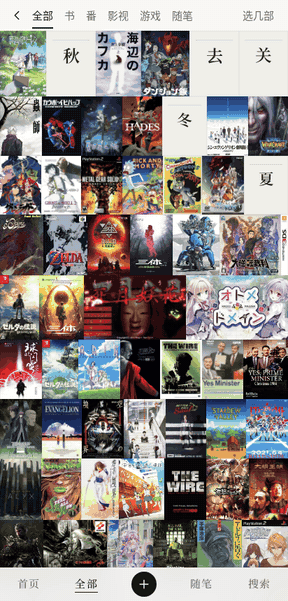
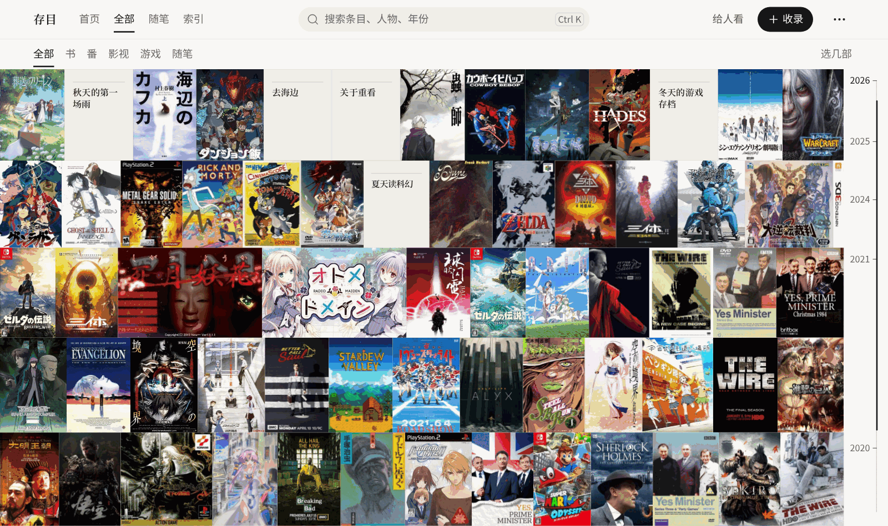
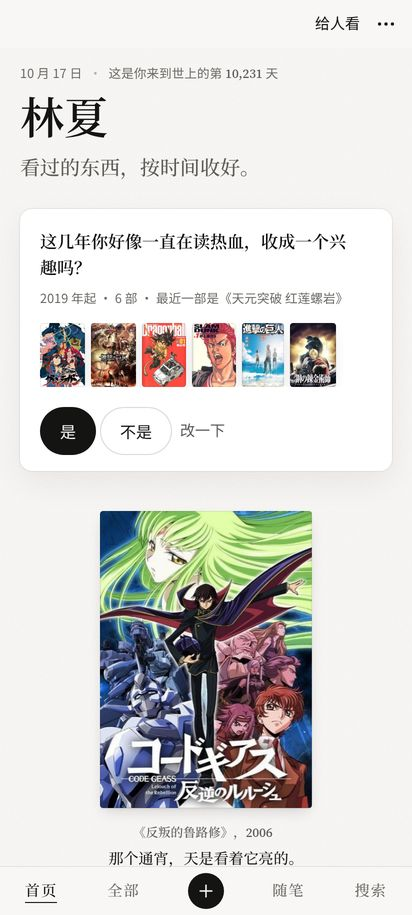
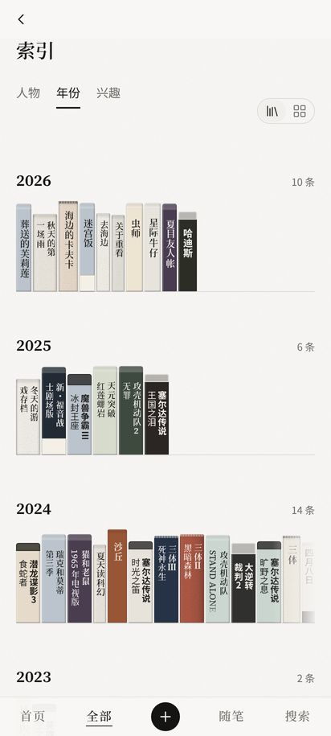
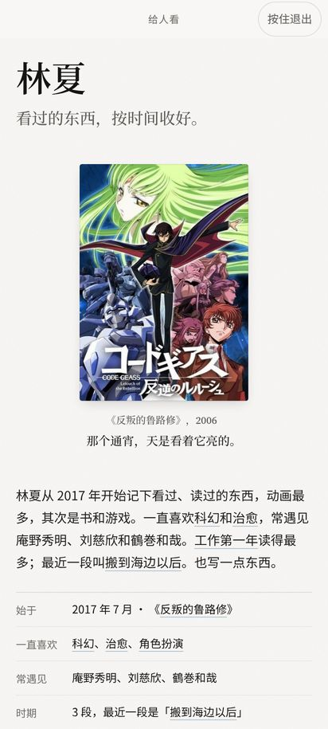
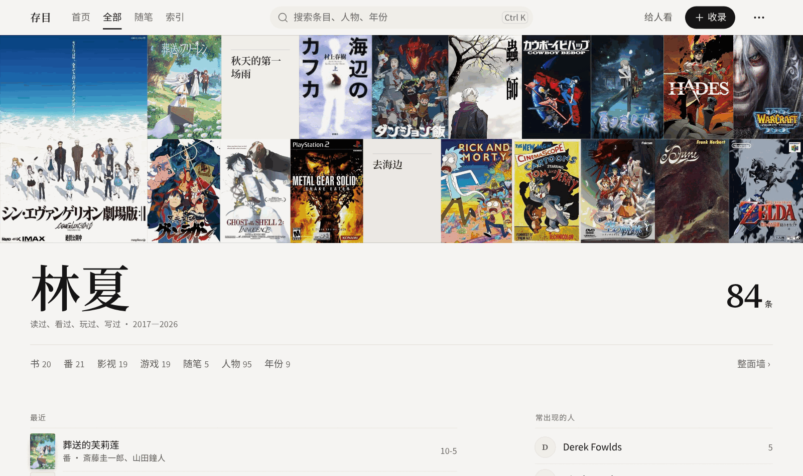

<div align="center">


# Cunmu · 存目

*存目 (cunmu) is the classical Chinese catalogue term for a book recorded by its title alone.*

**Keep the titles.** They're enough to remember by.

The anime you stayed up all night to finish one summer. The novel you read on the train to work. The save file with 200 hours on it.<br>
Cunmu gathers what you've logged across the web into a single book, and the book is about you.

No sign-up, no ads. Your records stay on your device; Cunmu only goes online when you connect Bangumi or Steam. Android · Windows · open source (GPL-3.0)

[](https://github.com/QZYH123/cunmu/actions/workflows/verify.yml)
[](LICENSE)
[](https://github.com/QZYH123/cunmu/stargazers)
[](https://github.com/QZYH123/cunmu/releases)


[中文](README.md) · **English**

<br>



<sub>The full cover wall → the page about you → one work → hand-over mode</sub>

</div>

<br>

<picture>
  <source media="(prefers-color-scheme: dark)" srcset="docs/media/hero-dark.png">
  
</picture>

**The interface is Chinese only.** Cunmu is built for people whose records live on Chinese services (Bangumi, Douban, WeRead), plus Steam.

## You've been keeping notes for years

A tick on Bangumi, a "read" on Douban, a play counter on Steam quietly adding up. Hundreds of entries, maybe thousands, spread over three or four sites, each one a single line.

Put together, they are the story of how you got here: the summer you fell for science fiction, the year you read on every commute, the show that kept you up until the sky went light.

Cunmu reads them in and writes a first draft for you: what you keep coming back to, the names you meet again and again, the chapters your life has had. You change a sentence and pick a few favourites.

## Only the title

The name comes from the *Siku Quanshu*, the vast imperial library compiled in 18th-century China. Some books were not copied in full; the editors kept only the title and a short abstract. That was called 存目 (*cunmu*), "keeping the title".

We think that's enough. No essays, no star ratings. A name, a date, a line of your own. Years later you see it again, and the summer comes back with it.

## One book, three parts

<table>
<tr>
<td width="33%" valign="top">


**The opening page is you**
Favourites, lasting interests, the named chapters of your life, your own notes. Suggested from your records; one tap to keep or let go.
</td>
<td width="33%" valign="top">


**A shelf for every year**
Books, anime, film and TV, music and games, shelved by year as spines or covers. Works by the same creator, from the same chapter, or on the same interest find each other.
</td>
<td width="33%" valign="top">


**Hand it across the table**
Hand-over mode shows only what you put on your opening page and hides anything marked private; press and hold to leave. Or save the page as one long image.
</td>
</tr>
</table>

### Everything: one wall of where you've been

Every record lives under 全部 (Everything): a cover wall on top, then counts by kind, people and year. 整面墙 (the full wall) fills the screen, with a year scale down the side to scroll back through.

<picture>
  <source media="(prefers-color-scheme: dark)" srcset="docs/media/all-dark.png">
  
</picture>

## Open to the first page

1. **Download** from [Releases](https://github.com/QZYH123/cunmu/releases): the Android `.apk`, or the Windows installer `Cunmu_…_x64-setup.exe` / portable `…-portable.exe`.
2. **Bring your records in** under 设置 › 来源 (Settings › Sources): a **Bangumi** username, a **Douban** backup file (tofu / doubak export), or your own **Steam** Web API key.
3. **Turn to the opening page.** The draft about you is already there. Change a line, pick a few favourites.

> Until the first release ships, Releases is empty and the downloads badge reads 0 or none. The Windows build isn't code-signed yet; if SmartScreen steps in, choose "More info → Run anyway". iOS comes later.

<details>
<summary>Build from source</summary>

Node 22 required.

```bash
git clone https://github.com/QZYH123/cunmu.git && cd cunmu
npm install
npm run dev       # dev server (empty library, same as the release build)
npm run verify    # type check, build, design-rule checks, unit tests, app smoke tests
```

Android, Windows and iOS builds and the code layout: [docs/DEVELOPING.md](docs/DEVELOPING.md).

</details>

## Yours alone

- No account, no Cunmu server, no analytics.
- Your records stay on your device. Cunmu only goes online to reach Bangumi or Steam, and only once you connect them.
- The Bangumi token and the Steam key never leave the device and are never written into an export.
- Export everything as a ZIP (data, Markdown, your own images), restore it from a file, or delete it all.

## Q&A

**New phone?** Export a ZIP on the old one and restore it on the new one.

**Is it affiliated with Bangumi or Douban?** No. It only reads your own records and never writes anything back.

**What about the covers in the screenshots?** They come from Bangumi and other sources and belong to their rights holders; they're shown only to illustrate the interface. The repository holds no cover files.

## Write with us

Issues and pull requests are welcome. Please read [CONTRIBUTING.md](CONTRIBUTING.md) first; it covers the copy and design rules.

## License

[GNU GPL v3 or later](LICENSE), © 2026 Yanagi (QZYH123). Bangumi, Steam, Douban and WeRead are trademarks of their respective owners.

## Star history

<a href="https://star-history.com/#QZYH123/cunmu&Date">
  
</a>
